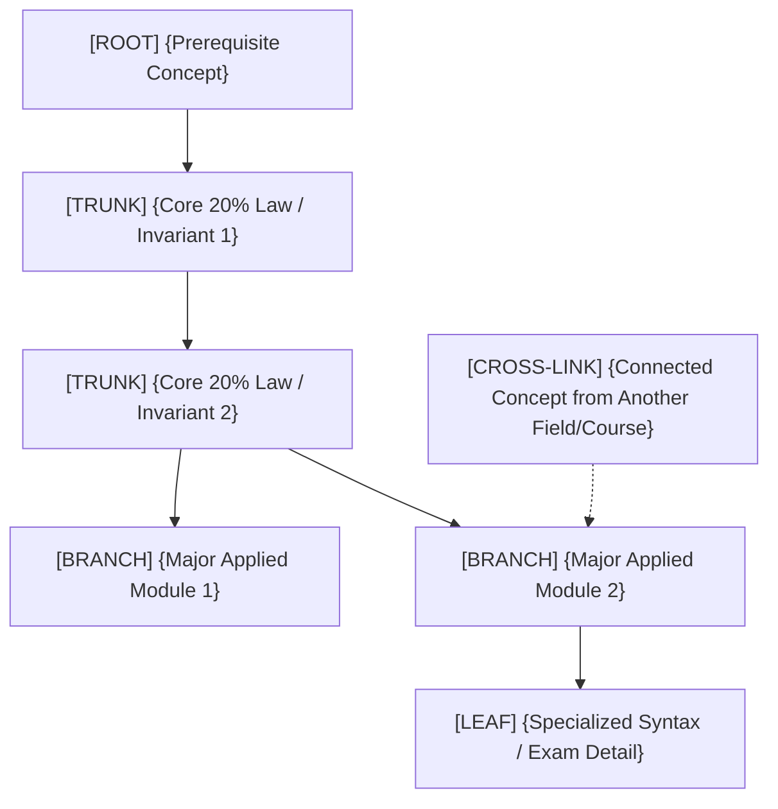

# Study Map (Setup & Incremental Subject Mapper)

Organize any technical field or academic course by **concept dependency**, never by chronological lecture order.

## Core Principles

1. **Semantic Tree First (`TREE.md`)**: Separate the 20% invariant `Trunk` laws (principles from which 80% of the subject inherits behavior) from `Root` prerequisites, applied `Branch` modules, exam-only `Leaf` details, and `Cross-Link` connections.
2. **1-Screen Compass Limit**: Keep `TREE.md` strictly under one screen (5–10 macro nodes in the Mermaid diagram). Never dump file inventories or weekly calendars into `TREE.md`.
3. **Course Overlay Second (`COURSE.md`)**: When studying for a class, store all mutating course logistics—deadlines, local slide PDF mappings, high-yield textbook chapters, exercise booklet indices, and missing material gaps—inside `COURSE.md`.
4. **Incremental Updates**: When new weekly slides or assignments arrive, inspect only the new files and attach them to existing nodes in `COURSE.md` and `TREE.md` without erasing prior `known` or `shaky` node statuses.

## Execution Steps

### Step 1: Detect Mode (Initial Setup vs. Incremental Update)

- Check whether `TREE.md` already exists in the current directory.
- **If `TREE.md` exists (Incremental Update)**:
  1. Diff the files in the workspace against the files listed in `COURSE.md` (or `TREE.md`).
  2. Read only the newly added files (new slide PDFs, homework sheets, notes) or user-requested topics.
  3. Proceed to Step 3 to update `COURSE.md` and `TREE.md` in place.
- **If `TREE.md` does not exist (Initial Setup)**:
  1. Scan the directory for local materials (syllabus, lecture slides, textbooks, exercise booklets, past exams, `PROGRESS.md`).
  2. If no local files exist, dispatch a background research subagent (or inspect primary textbooks/documentation) for the subject named by the user.
  3. If the user's immediate goal or active exam/homework deadline is not obvious from the files, ask at most **one** question via the native `question` tool to confirm their priority.

### Step 2: Apply 80/20 Corpus Triage (When Local Course Materials Exist)

- Compare all local slides and readings against the syllabus or exam scope.
- Isolate the 20% high-leverage chapters, slide decks, and practice problems that directly drive comprehension and deliverables.
- Record any syllabus topics that lack local slides or notes under `## Gaps in Local Materials` (`⚠`). Never invent silent filler to hide missing course files.

### Step 3: Write or Update `TREE.md` (Macro Subject Map)

Write `TREE.md` using this exact 1-screen structure:

```markdown
# Semantic Tree: {Subject Name}

**Mission**: {1–2 sentences stating the concrete outcome}

## 1. Concept Dependency Graph


## 2. Macro Node Status
| Node | Layer | Core Truth (Proposition) | Status |
| :--- | :--- | :--- | :--- |
| `R1` | ROOT | {1-sentence unconditional truth or prerequisite mechanic} | `unprobed` |
| `T1` | TRUNK | {1-sentence invariant principle governing subordinate branches} | `unprobed` |
| `B1` | BRANCH | {1-sentence applied rule inherited from T1/T2} | `unprobed` |
| `L1` | LEAF | {1-sentence boundary detail or exam-only rule} | `unprobed` |
```

Allowed status values: `unprobed`, `known`, `shaky`, `blocked`. Preserve existing status values during incremental updates.

### Step 4: Write or Update `COURSE.md` (Only When Course Files or Deadlines Exist)

When the workspace contains class materials, write `COURSE.md` to map local files and deadlines onto the `TREE.md` node IDs:

```markdown
# Course Overlay: {Course Code & Title}

## 1. Active Priorities & Deadlines
- **{Deliverable / Exam Name}** ({Date or Status}) -> Depends on nodes: `{Node IDs}`

## 2. Node-to-Material Index
| Node | Local Lecture Slides / Textbook Chapters (80/20 Filtered) | Practice Problems / Assignments |
| :--- | :--- | :--- |
| `T1` | `slides/01.pdf` (pp. 4–18), Textbook Ch. 2.1–2.3 | `eb1.pdf` Q1–Q4 |
| `B1` | `slides/06_monitors.pdf` (pp. 1–22) | `eb6.pdf` Q1–Q6, `HW3` |

## 3. Gaps in Local Materials
- ⚠ {Syllabus topic X has no uploaded slides yet; covered only by `eb7.pdf`}
```

### Step 5: Handoff Signpost

- Summarize what was mapped or updated in 3–5 bullet lines.
- Call the native `question` tool offering to launch the first recommended action immediately:
  1. `Learn recommended node ({Node ID}) via /study-topic (Recommended)`
  2. `Start practice problems for {Node ID or Deliverable} via /study-practice`
  3. `Stop here`
- If the user picks option 1 or 2, call the `skill` tool for `study-topic` or `study-practice` immediately.
- **Completion Criterion**: `TREE.md` (and `COURSE.md` if applicable) exists on disk, fits the 1-screen compass constraint, maps every discovered local file to a concept node, and prompts the user for the next skill handoff.
